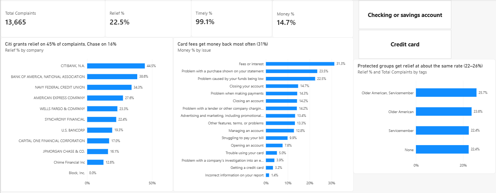

# Bank Complaints Analysis (CFPB, Nov–Dec 2025)

Which banks actually fix customer complaints, and what is hiding inside the vaguest complaint category?

**Tools:** Python (pandas) · SQL Server · Power BI · Ollama (local LLM)

## Data
- Source: CFPB Consumer Complaint Database narratives archive (FOIA reading room)
- Filter: Credit card + Checking or savings account, with narrative → 13,665 complaints
- Note: CFPB stopped publishing narratives on Aug 14, 2026. Narratives are unverified, consumer-side accounts.

## Business questions

1. Which banks (300+ complaints) resolve complaints with relief most and least often?
   - Metric: relief % (got_relief) by company, banks with 300+ complaints only
   - Who cares: a bank's complaints team benchmarking against competitors

2. Which issues drive credit card vs checking complaints, and which issues most often end with money back?
   - Metric: complaint count and money-relief % (got_money) by product and issue
   - Who cares: a product owner deciding which problem to fix first

3. Do Servicemember and Older American complaints get relief at the same rate as everyone else?
   - Metric: relief % by tag group (none / Servicemember / Older American / both)
   - Who cares: a compliance team checking fair treatment of protected groups

4. How does complaint volume change week by week over Nov–Dec 2025, and which banks spike during the holiday season?
   - Metric: weekly complaint count, overall and by company
   - Who cares: an operations manager planning complaint-team staffing

5. What are customers actually complaining about inside "Managing an account", the biggest and vaguest issue?
   - Metric: share of 200 hand-labelled narratives in each category (fraud/scam, frozen or closed account, funds held, access/login, fees, other),
     plus whether a local AI model can do the labelling reliably
   - Who cares: a risk or fraud team who can't act on a label as broad as "managing an account"

## Data cleaning log
| Step | Rows in | Rows out | Why |
|---|---|---|---|
| Load Nov–Dec 2025 archive | — | 1,009,132 | Aug 2026 file had 1 narrative (CFPB stopped publishing) |
| Keep credit card + checking/savings with narrative | 1,009,132 | 13,665 | Questions are about banks; AI part needs text |
| Duplicate Complaint IDs | 13,665 | 13,665 | 0 found |
| Missing values | 13,665 | 13,665 | Tags blank = not tagged; others not used or small; no rows dropped |

## Data quality issue found
A weekly chart showed a big dip in early December. Looking day by day, narratives drop to almost zero on some weekdays
(Dec 11: 5, Dec 12: 7, Dec 17: 12) while the total number of complaints filed stays normal (~600 a day).
So the dip is the CFPB not publishing narratives on those days, not customers complaining less.
That is why **Q4 (weekly volume) was dropped**: any trend from this file would show the publishing gap, not real behaviour.

## Findings

1. **Citibank and Bank of America close complaints with relief 2-3x as often as Chase and Capital One**
   (44.5% and 38.6% vs 16.1% and 17.0%). The gap holds within each product (credit card: Citi 45.0% vs Chase 20.9%;
   checking: 42.8% vs 12.8%), so it is not a product-mix effect. Block, Inc. gave relief on 0 of 419 complaints.
2. **Credit card fees and interest get money back most often (31.3%)**, then disputed purchases (23.5%).
   A fee is a clear amount a bank can reverse. The largest issue, "Managing an account" (3,836 complaints),
   gets money back only 12.8%.
3. **Servicemember and Older American complaints get relief at about the same rate as everyone else (22-26%).**
   The highest group (Older American + Servicemember, 25.7%) has only 210 complaints, so the gap is within noise.

**Limits:** complaints are unverified, consumer-side accounts and only include people who chose to publish a narrative.
Results describe complaint outcomes, not overall bank quality or why each decision was made.

## Q5: What is really inside "Managing an account"?
"Managing an account" is the biggest issue (3,836 complaints) and too vague to act on.
I labelled a random sample of **200** of these narratives (`random_state=42`) using written rules. An AI assistant then flagged labels that broke the rules, and I checked each flagged change
(59 of 200 changed; original and reviewed labels, plus the reason for each change, are kept in `data/processed/label_sample_200.xlsx`).

| Label | Meaning | Count | Share (95% range) |
|---|---|---|---|
| fraud_scam | Someone else took money without permission, a scam, or a denied unauthorized-transaction dispute | 61 | 30.5% (24-37%) |
| other | Merchant disputes, bonuses, service, bank errors | 42 | 21.0% (15-27%) |
| frozen_closed | The bank froze, restricted, locked or closed the account | 41 | 20.5% (15-26%) |
| funds_held | A deposit, check, transfer or refund held, delayed or missing | 34 | 17.0% (12-22%) |
| access_login | Can't log in, card blocked, while the account is open | 21 | 10.5% (6-15%) |
| fees | A fee or overdraft charge | 1 | 0.5% |

**Finding:** about **1 in 3** "Managing an account" complaints is really about **fraud or unauthorized transactions**, and **1 in 5** is the bank
freezing or closing the account. CFPB's category hides both. In this sample, fraud complaints got money back only **8%** of the time (5 of 61).
(Small groups: treat rates as directional.)

**Lesson from the review:** my first pass labelled anything mentioning "fraud" as fraud_scam, even when the *bank* had frozen the account
over suspected fraud. The rule is about what happened to the customer, not the words used.

### Can a local AI do this labelling?
I ran two small models on my laptop with Ollama (free) and checked them against my labels before trusting them.
Rows 0-99 were used to compare prompts; rows 100-199 were kept aside and used once for the final score.

| Prompt | Model | Labels | Rows | Accuracy |
|---|---|---|---|---|
| v1 (definitions) | Llama 3.2 3B | first pass | 100 | 31% |
| v2 (sharper rules + examples) | Llama 3.2 3B | first pass | 100 | 35% |
| v2 | Qwen 2.5 3B | first pass | 100 | 41% |
| v2 | Qwen 2.5 3B | reviewed | dev 100 | 48% |
| v3 (decision order) | Qwen 2.5 3B | reviewed | dev 100 | 54% |
| **v3, final test (run once)** | **Qwen 2.5 3B** | **reviewed** | **test 100 (unseen)** | **71%** |

I set the bar before testing: use AI labels only if the held-out test score is 70% or more.

It scored **71%**, just over the bar, but I treat that as borderline:
- With only 100 test rows, the real accuracy could be anywhere from about 62% to 80%.
- The same prompt scored 54% on the dev rows, so some of the 71% is probably luck in which complaints landed where.
- Its most common mistakes: mixing up held funds with fraud or frozen accounts, and calling some frozen accounts "other".

So the Q5 finding uses my reviewed labels. The model is useful as a first sorter that a person checks, not for reporting numbers on its own.

What helped most was not a bigger model: it was fixing my own labels and giving the model questions to answer in order (41% to 54% on the same rows).

## How to run
1. Download the Nov-Dec 2025 file from the CFPB narratives archive into `data/raw/`.
2. Run `notebooks/01_explore.ipynb` (creates `data/processed/bank_clean.csv`).
3. Run `sql/01_create_and_load.sql` in SQL Server (copy the CSV to `C:\SQLData\` first), then `sql/02_business_questions.sql`.
4. Open `bank_complaints.pbix` in Power BI Desktop (Home -> Refresh).
5. For Q5: install Ollama, run `ollama pull qwen2.5:3b`, then `notebooks/03_ai_labels.ipynb` (about 40 minutes on a laptop CPU).

## What I'd do next
- Load all complaints (with and without narratives) to rebuild the weekly trend properly.
- Label more complaints and test a bigger model to see if the AI can pass the bar clearly.
